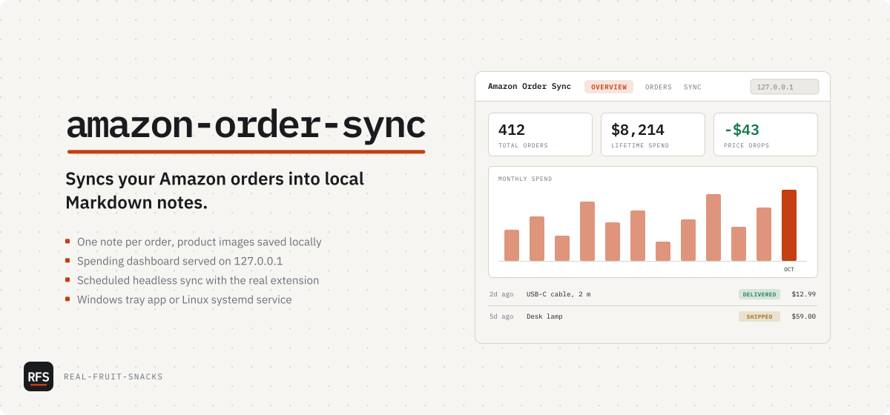

# amazon-order-sync

Syncs your Amazon orders into local Markdown notes.

<picture>
  <source media="(prefers-color-scheme: dark)" srcset="docs/assets/cover-dark.svg">
  
</picture>

Windows (PowerShell; the repo is private, so `gh` must be signed in):

```powershell
gh release download --repo Real-Fruit-Snacks/amazon-order-sync --pattern amazon-order-sync-windows.zip --clobber
Expand-Archive amazon-order-sync-windows.zip "$env:LOCALAPPDATA\Programs\amazon-order-sync" -Force
Set-ExecutionPolicy -Scope Process Bypass; & "$env:LOCALAPPDATA\Programs\amazon-order-sync\install.ps1"
```

Linux (systemd user service, Node.js 18 or newer):

```sh
gh release download --repo Real-Fruit-Snacks/amazon-order-sync --pattern amazon-order-sync-linux.tar.gz --clobber
tar xzf amazon-order-sync-linux.tar.gz && ./amazon-order-sync/install.sh
```

Then load the extension: open `brave://extensions` (or `chrome://extensions`, `edge://extensions`), turn on Developer mode, choose **Load unpacked** and pick the `browser-extension` folder the installer prints. Open your Amazon order history and press **Sync Current Page**.

Amazon's order history is a slow, paged website. This keeps a copy of it as plain Markdown files, one per order, with the product images saved next to them, so you can search, chart and keep it without Amazon. Everything runs on your computer: a small Node.js server on `127.0.0.1`, a browser extension that reads your order pages, and, on Windows, a tray app. Nothing goes to any other server unless you add a Gemini key for review drafts.

## What's in it

| Part | Does |
|---|---|
| `server/` | Node.js server, no npm dependencies. Writes the notes, caches images, serves the dashboard and the API at `http://127.0.0.1:27483` |
| `server/dashboard.html` | Dashboard: spend by month, orders, price drops, repeat purchases, review drafts, sync status, CSV/JSON export, backfill import |
| `browser-extension/` | Reads your Amazon order pages and sends them to the server; fills Amazon's review form from a saved draft for you to edit and post |
| `tray/` | Windows tray app (C#, .NET 8): starts the server hidden, shows notifications, menu for sync, login, notes and logs |
| `install.ps1`, `install.sh` | Installers for Windows (tray app, start with Windows) and Linux (systemd user service) |
| Headless sync | On a schedule the server runs your browser headless with the extension, after a one-time login |
| Review drafts | Optional. With a Gemini key, a draft review per item that you rewrite in your own words before posting |

The full guide, with configuration, the dashboard tabs, headless sync and troubleshooting, is in [docs/guide.md](docs/guide.md). The HTTP API is in [docs/api.md](docs/api.md).

## Tested on

- Windows with Brave and the tray app: my own setup, daily
- CI on every push: server tests on Ubuntu (Node.js 18 and 22) and Windows (Node.js 22; the headless-run tests need a POSIX shell and are skipped there), a tray app build on Windows, the installers checked with Windows PowerShell 5.1, PSScriptAnalyzer and shellcheck
- *Not* tested: macOS, Firefox, Amazon sites other than amazon.com in day-to-day use

## Known issues

- Google Chrome ignores `--load-extension` since version 137, so headless sync can't load the extension there. Use Brave, Edge or Chromium for headless runs; manual sync from the popup works in Chrome.
- The extension reads Amazon's pages as they are today. When Amazon changes its order or review pages, sync or auto-fill can break until the extension is updated.
- Each item in a note ends with a line of `---`. If you edit a note by hand, don't add a `---` line inside a review; the dashboard's editor rewrites one as `- - -` for you.
- The headless browser profile holds a signed-in Amazon session. It stays on your computer, in `%LOCALAPPDATA%\amazon-order-sync\browser-profile` or `~/.local/share/amazon-order-sync/browser-profile`; delete it to sign out.

## Configuration

The config file is `%APPDATA%\amazon-order-sync\config.json` on Windows and `~/.config/amazon-order-sync/config.json` on Linux; set `AMAZON_SYNC_CONFIG` to use another. The installer creates it on first run and never overwrites it.

| Key | Default | Meaning |
|---|---|---|
| `notesPath` | `~/AmazonOrders` | Folder for the notes and images |
| `port` | `27483` | The extension expects this port; change both or neither |
| `autoSyncEnabled` | `false` | Headless sync on a schedule, every `autoSyncIntervalHours` (24) |
| `browserPath` | autodetect | Browser for headless runs; Brave, Edge and Chromium are tried before Chrome |
| `geminiApiKey` | empty | Turns on review drafts; `GEMINI_API_KEY` also works |

Every key, including notifications, review checks and the Gemini limits, is in [docs/guide.md](docs/guide.md#configuration). On Windows, use the tray menu's **Edit config.json**, then **Restart server**.

## License

MIT. IBM Plex is under the SIL Open Font License (`server/fonts/OFL.txt`).
