# amazon-order-sync

Syncs your Amazon orders into local Markdown notes.

<picture>
  <source media="(prefers-color-scheme: dark)" srcset="docs/assets/slip-dark.svg">
  
</picture>

Amazon's order history is a slow, paged website. This keeps a copy of it on your computer: one Markdown file per order, filed by month, with the product images saved next to them. A browser extension reads your order pages and hands them to a small Node.js server on `127.0.0.1`, which writes the notes and serves a dashboard; on Windows a tray app keeps it running. Nothing goes to any other server unless you add a Gemini key for review drafts.

The orders above are made up. The notes are what the server wrote for them, unedited, in [docs/samples](docs/samples); CI runs the server on those orders again on every push and fails if its output changes.

Windows (PowerShell):

```powershell
$zip = "$env:TEMP\amazon-order-sync-windows.zip"
Invoke-WebRequest https://github.com/Real-Fruit-Snacks/amazon-order-sync/releases/latest/download/amazon-order-sync-windows.zip -OutFile $zip
Expand-Archive $zip "$env:LOCALAPPDATA\Programs\amazon-order-sync" -Force
Set-ExecutionPolicy -Scope Process Bypass; & "$env:LOCALAPPDATA\Programs\amazon-order-sync\install.ps1"
```

Linux (systemd user service, Node.js 18 or newer):

```sh
curl -fsSL https://github.com/Real-Fruit-Snacks/amazon-order-sync/releases/latest/download/amazon-order-sync-linux.tar.gz | tar xz && ./amazon-order-sync/install.sh
```

With no network: the Windows zip carries its own Node.js, so copy it over, expand it and run `install.ps1` from that folder; nothing is downloaded. The Linux tarball needs Node.js 18 or newer already installed.

Then load the extension: open `brave://extensions` (or `chrome://extensions`, `edge://extensions`), turn on Developer mode, choose **Load unpacked** and pick the `browser-extension` folder the installer prints. Open your Amazon order history and press **Sync Current Page**.

## Where the notes go

Every file the server wrote for the three sample orders:

<!-- sample-files:begin -->
```text
~/AmazonOrders/Orders/2026/08-August/Order-114-6203318-0071592.md
~/AmazonOrders/Orders/2026/09-September/Order-113-0927751-3104428.md
~/AmazonOrders/Orders/2026/10-October/Order-112-4418203-6650917.md
~/AmazonOrders/Orders/assets/B0DCBL6062.jpg
~/AmazonOrders/Orders/assets/B0DLMP4207.jpg
~/AmazonOrders/Orders/assets/B0DNTB2213.jpg
~/AmazonOrders/Orders/assets/B0DSKL1035.jpg
```
<!-- sample-files:end -->

The frontmatter is one array per field, in item order: the second brand, price and ASIN belong to the second item. Below it, each item gets its own section. Here is the cable from the October order. Its review was already posted on Amazon, so the note holds what was posted:

<!-- sample-item:begin -->
```markdown
### Braided USB-C Cable, 6 ft, 2-Pack


#### Features
Nylon braid, aluminum ends
- 60 W charging

#### 📝 My Review
[✍️ Leave a Review on Amazon](https://www.amazon.com/review/create-review?asin=B0DCBL6062)

**Title:** Long enough to reach the sofa
**Review:** Both still work after three months of being stepped on. The ends are a little bulky for my phone case.
- [x] Posted to Amazon?

---
```
<!-- sample-item:end -->

Syncing an order again rewrites its details and keeps what you wrote: a review typed under the placeholder, a draft you saved, a box you ticked.

## What's in it

| Part | Does |
|---|---|
| `server/` | Node.js server, no npm dependencies. Writes the notes, caches images, serves the dashboard and the API at `http://127.0.0.1:27483` |
| `server/dashboard.html` | Dashboard: spend by month, orders, price drops, repeat purchases, review drafts, sync status, CSV/JSON export, backfill import |
| `browser-extension/` | Reads your Amazon order pages and sends them to the server; fills Amazon's review form from a saved draft for you to edit and post |
| `tray/` | Windows tray app (C#, .NET 8): starts the server hidden, shows notifications, menu for sync, login, notes and logs |
| `install.ps1`, `install.sh` | Installers for Windows (tray app, start with Windows) and Linux (systemd user service) |
| Headless sync | On a schedule the server runs your browser headless with the extension, after a one-time login |
| Review drafts | Optional. With a Gemini key, a draft review per item that you rewrite in your own words before posting |

The full guide, with configuration, the dashboard tabs, headless sync and troubleshooting, is in [docs/guide.md](docs/guide.md). The HTTP API is in [docs/api.md](docs/api.md). The [project page](https://real-fruit-snacks.github.io/amazon-order-sync/) has dashboard screenshots.

## Tested on

- Windows with Brave and the tray app: my own setup, daily
- CI on every push: server tests on Ubuntu (Node.js 18 and 22) and Windows (Node.js 22; the headless-run tests need a POSIX shell and are skipped there), a tray app build on Windows, the installers checked with Windows PowerShell 5.1, PSScriptAnalyzer and shellcheck, and the sample orders above synced through the real server
- *Not* tested: macOS, Firefox, Amazon sites other than amazon.com in day-to-day use

## Known issues

- Google Chrome ignores `--load-extension` since version 137, so headless sync can't load the extension there. Use Brave, Edge or Chromium for headless runs; manual sync from the popup works in Chrome.
- The extension reads Amazon's pages as they are today. When Amazon changes its order or review pages, sync or auto-fill can break until the extension is updated.
- Each item in a note ends with a line of `---`. If you edit a note by hand, don't add a `---` line inside a review; the dashboard's editor rewrites one as `- - -` for you.
- A note links its images as `assets/<ASIN>.jpg`, but the images sit in `Orders/assets/`, not in the note's month folder. The dashboard finds them by ASIN; a Markdown editor that resolves the link from the note's own folder shows a broken image.
- The headless browser profile holds a signed-in Amazon session. It stays on your computer, in `%LOCALAPPDATA%\amazon-order-sync\browser-profile` or `~/.local/share/amazon-order-sync/browser-profile`; delete it to sign out.

## Configuration

The config file is `%APPDATA%\amazon-order-sync\config.json` on Windows and `~/.config/amazon-order-sync/config.json` on Linux; set `AMAZON_SYNC_CONFIG` to use another. The installer creates it on first run and never overwrites it.

| Key | Default | Meaning |
|---|---|---|
| `notesPath` | `~/AmazonOrders` | Folder for the notes and images |
| `port` | `27483` | The extension expects this port; change both or neither |
| `autoSyncEnabled` | `false` | Headless sync on a schedule, every `autoSyncIntervalHours` (24) |
| `browserPath` | autodetect | Browser for headless runs; Brave, Edge and Chromium are tried before Chrome |
| `geminiApiKey` | empty | Turns on review drafts; `GEMINI_API_KEY` also works |

Every key, including notifications, review checks and the Gemini limits, is in [docs/guide.md](docs/guide.md#configuration). On Windows, use the tray menu's **Edit config.json**, then **Restart server**.

## License

[MIT](LICENSE). Not affiliated with Amazon. IBM Plex, in the dashboard and extension, is under the SIL Open Font License (`server/fonts/OFL.txt`); so are Archivo and Martian Mono, on the project page and in the picture above (`docs/fonts/`). [Changelog](CHANGELOG.md) · [Security](SECURITY.md) · [Contributing](CONTRIBUTING.md)
